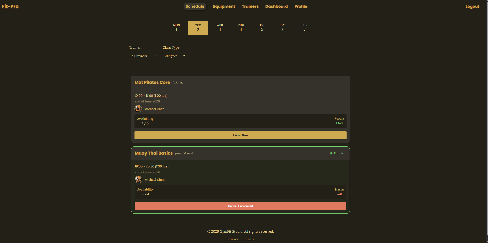
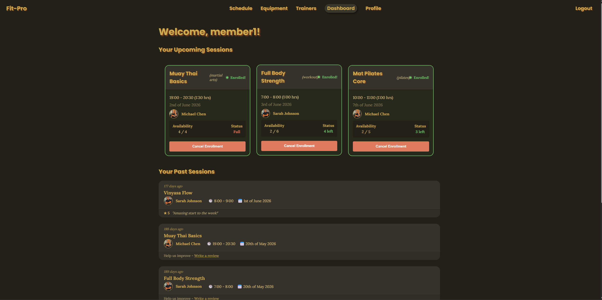
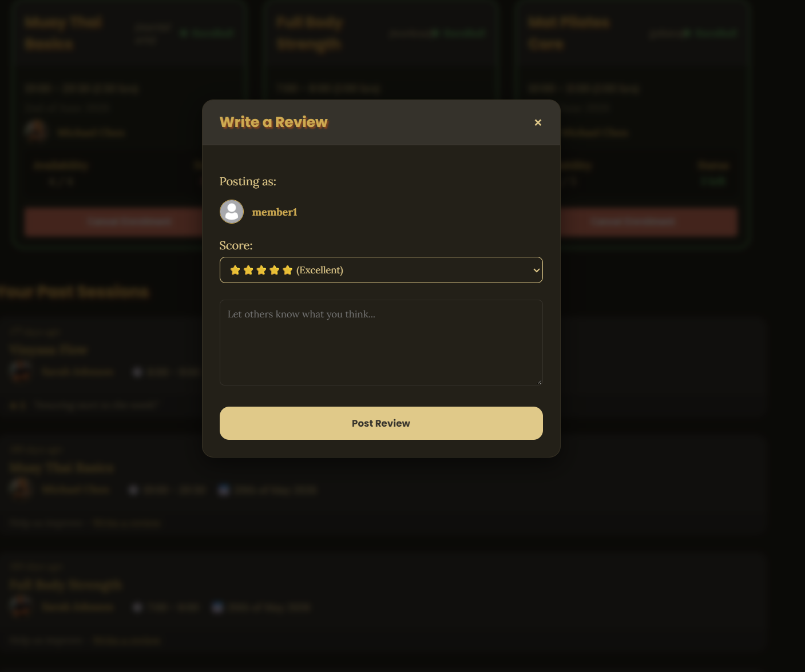
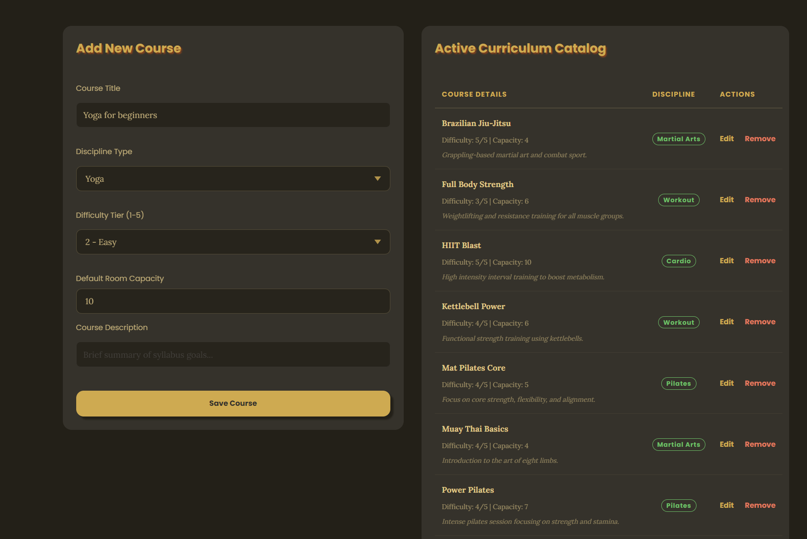

# Gym Management System [ LTW - University of Porto ]

## Overview

A web app for running a gym, with three roles. **Members** browse and enroll in classes, **trainers** manage their schedules and rosters, and **admins** manage users, classes and equipment and can view analytics. It is a university team project, built without frameworks to practise CRUD operations and session-based authentication.

| | |
|---|---|
| **Backend** | PHP 8 (no framework), PDO with prepared statements |
| **Database** | SQLite with foreign keys enforced ([ER diagram](docs/db_ER_diagram.md)) |
| **Frontend** | Server-rendered PHP templates, vanilla JS (`fetch` for async admin and enrollment actions), plain CSS with a mobile-first responsive layout |
| **Architecture** | `public/` holds the page controllers and `action_*.php` form handlers; `src/models/` holds the data access layer, `src/templates/` the reusable view components and `src/auth.php` the auth guards |
| **Auth & Security** | PHP sessions, `password_hash`/`password_verify`, role-based access (`requireRole`), CSRF tokens on all form actions, output escaping |
| **Testing** | Assertion-based model tests in `tests/` |

Quick start: `sqlite3 database/gym.db < database/gym.sql && php -S localhost:9000 -t public`, then log in as `admin` / `1234`.

## Screenshots

### 📅 Class Schedule
Pick a day of the week, filter by trainer or class type, and grab a spot. Every class card shows its time, duration, trainer and how many places are left. Enroll in one click, or cancel just as fast if plans change.



### 🏠 Member Dashboard
All your training in one place. Upcoming sessions sit at the top with their full details, and your past sessions are listed below, each with a prompt to leave a review.



### ⭐ Reviews
Loved the class? Hated it? Give it a 1–5 star score and a comment from a quick popup, without leaving the dashboard.



### 🛠️ Admin Panel
Admins run the class catalog. They can add new courses with a discipline, difficulty tier, default capacity and description, then edit or remove existing ones from the live catalog.



## Features

**All users:**
- [x] Register a new account.
- [x] Log in and out.
- [x] Edit their profile, including name, username, password, and profile photo.

**Members:**
- [x] Browse the schedule of available fitness classes, filtering by type, trainer, day, or time.
- [x] Enroll in and cancel enrollment from upcoming classes, subject to capacity limits.
- [x] View trainer profiles, including their specializations and the classes they teach.
- [x] Check the current availability of equipment in the main training area.
- [x] Leave ratings and reviews for classes they have attended.

**Trainers:**
- [x] Manage their public profile, including bio, specializations, and certifications.
- [x] View the roster of members enrolled in their classes.
- [x] Track and manage their assigned class schedule.

**Admins:**
- [x] Manage members and trainers (create, update, and deactivate accounts).
- [x] Manage the class catalog (create, edit, and remove classes).
- [x] Manage equipment in the main training area (add, update availability status, and remove items).
- [X] Elevate a user to admin status.
- [x] Oversee and ensure the smooth operation of the entire system (via Analytics Panel).

**Extra:**
- [x] Dynamic Home Page with live database information.
- [x] Admin Analytics Dashboard (Session statistics, User distribution, etc.).
- [x] CSRF Protection for all sensitive actions.
- [x] Responsive layout for mobile and desktop.
- [x] Admins can view gym-wide metrics such as most
      popular classes, equipment usage, and trainer performance.
- [x] Admins can highlight specific classes or trainers
      on the homepage through featured promotions (Implemented via dynamic live-data
      highlighting).
- [x] Implementation of CSRF protection for all form actions
      and a fully responsive mobile-first design.

## Running

Initializing the database:
```bash
cd database
sqlite3 gym.db < gym.sql
```

Starting the server:
```bash
cd ..
php -S localhost:9000 -t public
```

## Credentials

All accounts use the password: **1234**

- **Admin:** `admin`
- **Trainers:** `trainer1`, `trainer2`, `trainer3`
- **Members:** `member1`, `member2`, `member3`, `member4`, `member5`

## File Structure

```
├── database/
│   ├── gym.db                   # SQLite database
│   └── gym.sql                  # Database schema and seed data
├── public/
│   ├── index.php                # Home page
│   ├── sessions.php             # Class schedule
│   ├── trainers.php             # Trainers list
│   ├── equipment.php            # Equipment inventory
│   ├── dashboard.php            # User dashboard
│   ├── edit_profile.php         # Profile management
│   ├── login.php / register.php # Authentication
│   ├── admin_*.php              # Admin management pages
│   ├── css/                     # Stylesheets
│   ├── js/                      # JavaScript logic
│   └── uploads/                 # User-uploaded content
├── src/
│   ├── auth.php                 # Authentication logic
│   ├── database.php             # Database connection singleton
│   ├── models/                  # Database interaction models
│   ├── templates/               # Reusable UI components
│   └── Utils/                   # Helper functions
└── tests/                       # Unit tests
```
